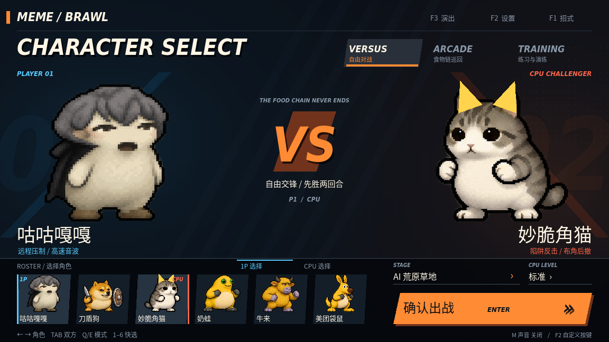

# 模因乱斗：抽象食物链

[72 秒新版街机界面演示](Meme-Brawl-Showcase.mp4) · [下载完整 Godot 工程包](Meme-Brawl-Godot.zip) · [打开独立 Godot 工程](meme-brawl/project.godot) · [运行、键位与完成范围](meme-brawl/README.md)

六角色横版格斗原型：咕咕嘎嘎、刀盾狗、妙脆角猫、奶蛙、牛来、美团袋鼠；含 AI 对战、街机巡回、练习、UIOP 快捷技能、EX、CA、V 技能、黄色三幻神 V 触发与六张角色主场。Godot 4.3+ 打开工程按 F5，F1 查看招式。已导入原创像素图集与六角色各 27 种状态动画；咕咕嘎嘎与猫各有 16 姿势独立图集，完善了迁徙空战、脆角再生与落地陷阱。原版梗录音因抖音访问受阻尚未导入，当前仍为合成音效；动画使用关键姿势和变换，不是商业级逐帧手绘演出。

新版界面加入延迟扣血、低血警示、独立 V 槽和三格超必杀槽、真实三局两胜、VS／CA／KO 过场。按 F3 观看六角色演出，Enter／空格跳过，Esc 退出。[界面说明](meme-brawl/docs/UI_GUIDE.md)。

已修复角色串帧与武器裁切，包含刀盾狗完整刀尖、举刀和猫的逐姿势脆角锚点。[逐帧检查图](meme-brawl/docs/SPRITE_FIX.md)。

操作简化为 **J/K/L 攻击、U/I/O 技能、Shift+技能强化、P 大招**。咕咕嘎嘎主远程、奶蛙主连招（专属 14 连击）、狗主盾反、猫主陷阱、牛来主蓄力重击、袋鼠主中距腿技。练习 F4 看打法、F5 角色演练。[简化出招表与角色说明](meme-brawl/docs/ROLE_GUIDE.md)。

选角重做为双侧大立绘、中央 VS、底部横向头像带、顶部模式标签和单一橙色确认入口；**F2 设置可修改并保存全部战斗键位**，出招表与提示实时同步。[新版界面与实机截图](meme-brawl/docs/ARCADE_UI.md)。

咕咕嘎嘎已按用户附图重制为灰卷毛、奶白圆身、黑披风造型，补齐 16 个战斗姿势并同步到所有界面。[动作与实机截图](meme-brawl/docs/GUGU_REWORK.md)。

六角色原创 BGM 与专属技能音效已接入，详见 [音频设计](meme-brawl/docs/CHARACTER_AUDIO.md)。当前仓库工作区仅保留模因乱斗项目；无关项目已清理，历史仍可从 Git 恢复。

六张重设计主场已接入自动主场、手动选图与环境技能联动，详见 [主场设计与实机截图](meme-brawl/docs/HOME_STAGES.md)。
