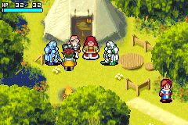

# 光明之魂 1 · Godot 逆向工作台

**当前未完成彻底完整逆向，也未完成可通关的 Godot 移植。**

[下载完整工程和分析证据](https://github.com/2502511622-rgb/rouge/raw/refs/heads/main/shining-soul-godot.zip) · [Godot 工程源码](godot/) · [中文说明](godot/README_中文.md) · [完成范围](godot/docs/STATUS.json)

解压后用 Godot 4.3+ 打开 `project.godot`。默认是从上传 ROM 的真实运行状态恢复的村庄，包含可编辑 TileMapLayer、TileSet 与独立 Sprite2D；不是嵌入模拟器，也不是一张平面截图。运行时 1/2/3 切换村庄、标题、对白；P 打开旧版占位动作原型。真实场景目前为静态检查点，不能作为原作可玩移植。

## 已验证

- 原 ROM 带中文汉化内容；已进入村庄并观察移动、攻击、菜单。
- 三个检查点从显存、OAM 和调色板独立重建，每帧 38,400 像素，RGB 差异均为 0。
- 冷启动重放至村庄后，帧、VRAM、OAM、调色板逐字节相同。
- 1,851 项非平凡背景图块记录均找到相同 ROM 字节；未据此声称已还原完整加载路径。
- Godot 原生图块层与独立精灵场景加载通过，旧占位原型的功能检查仍通过。

## 尚未完成

完整地图/碰撞、角色与敌人动画、战斗公式、AI、职业技能、装备掉落、任务事件、完整文本、音乐音效、存档、联机和全流程对照测试。原始 ROM 不包含在仓库或压缩包内。

