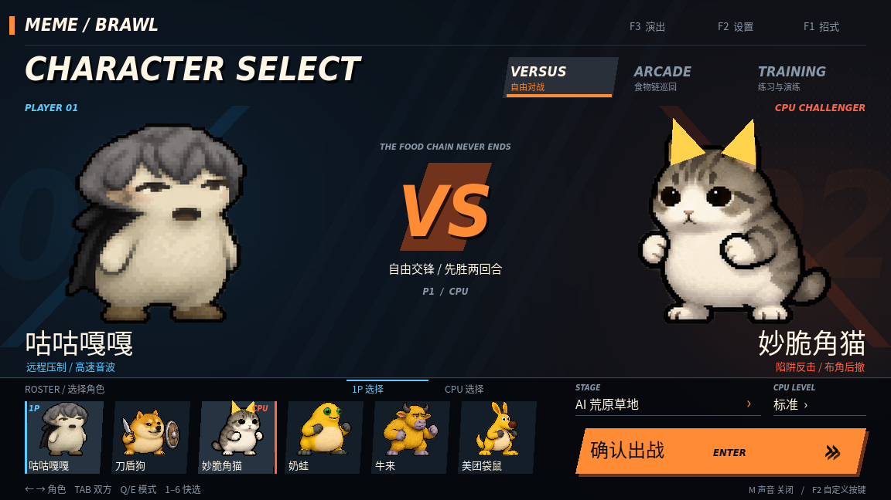
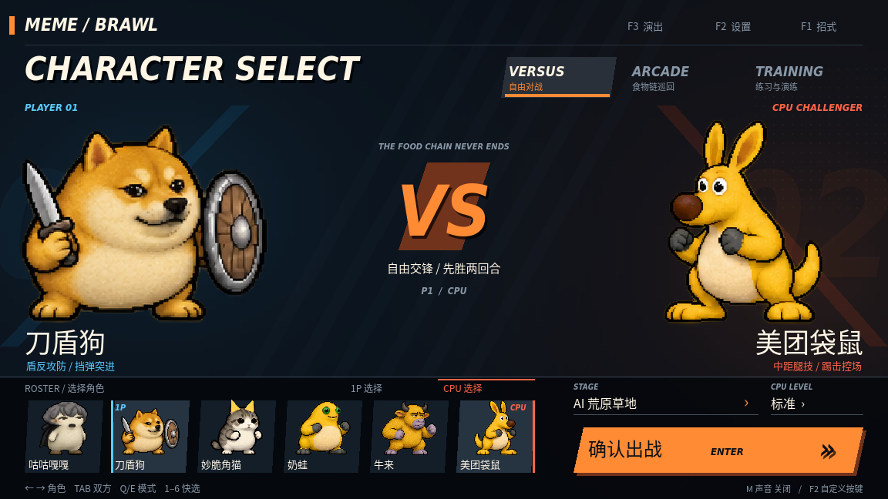
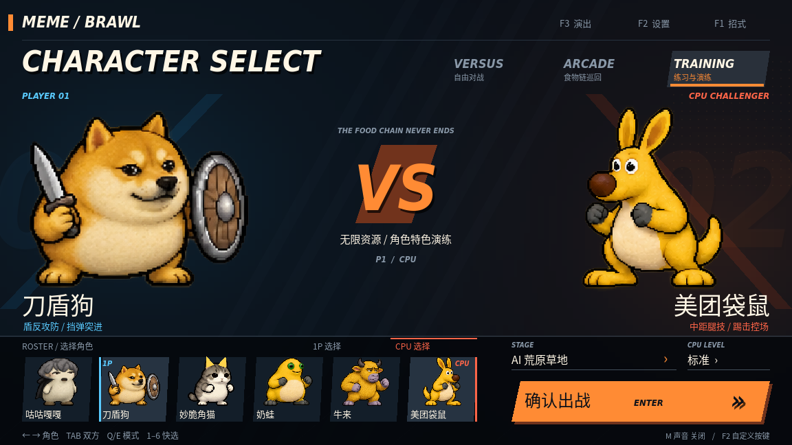
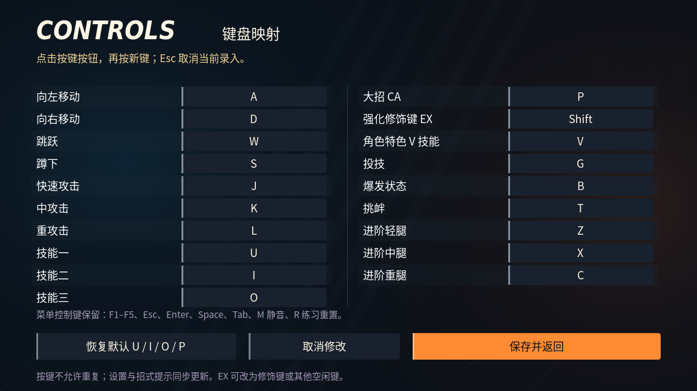
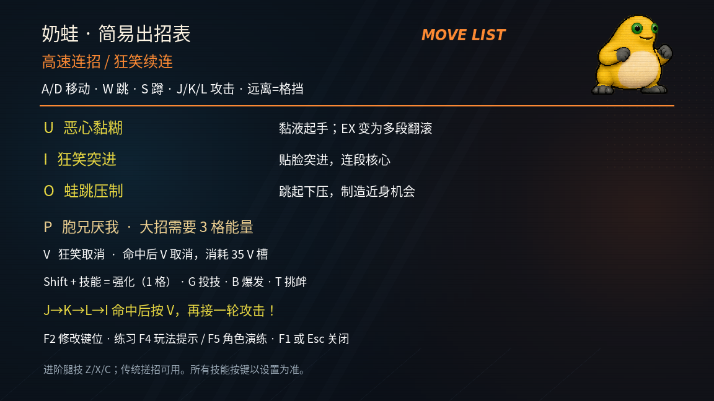
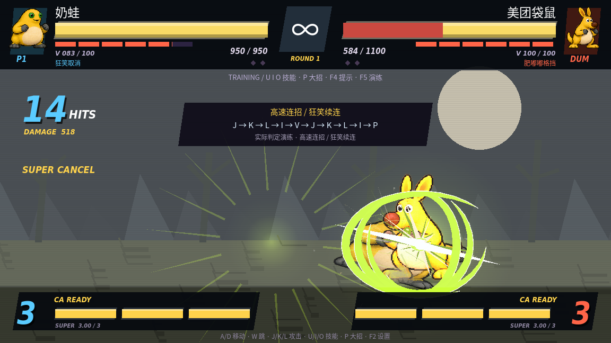

# 街机界面重做

本轮按照街霸／拳皇类格斗界面的信息层级重做：大标题、双方角色、醒目的 VS、底部头像带、模式标签与唯一的出战确认。采用本作的角色素材、字体和程序绘制界面。

选角页使用深蓝黑底、暖白字、橙金确认区，以及蓝／红双方标记。光晕、斜切线、半色调点阵和角色切换滑入统一构成画面；底部原来的多行功能按钮改为角色头像带、两项对战参数和单一「确认出战」。

## 选角与进入模式

- 顶部点选 VERSUS 自由对战、ARCADE 街机、TRAINING 练习；Q/E 也可切换模式。
- 点击下方头像或用方向键／数字 1–6 选择角色。Tab 或头像带上方的 1P／CPU 标签切换选择方。
- 自由对战和练习可独立选 CPU。街机自动编排对手，右侧预览显示真实首战对手，CPU 标签显示「自动」。
- 舞台和难度放在右下角的紧凑参数区；确认出战或 Enter 进入当前模式。
- F2 设置、F1 招式、F3 演出收在顶部小导航中；M 静音仍可使用。

## 其余界面

战斗 HUD 改为经典黄生命条、红色扣血残影和蓝／红玩家色。三格能量、真实 V 槽、胜点、连击和取消提示继续读取实际战斗数据。大字增加暗色投影，VS、FIGHT、CA、KO 和结果页使用同一组视觉色。

设置、招式页和暂停入口采用同一深色底与橙色强调。设置页仍能修改、保存 19 个战斗键位，输入字段与主保存操作有明确区分。

默认 U/I/O 三技能、P 大招，Shift+技能为 EX；F2 可改键。模式标签只是选角界面的导航，不改变战斗中的 Q/E 自定义绑定。

## 验证

- 图形检查使用真实鼠标事件选择整张头像、切换双方、打开设置、录入新键、选择练习并点击唯一确认入口。
- 控制检查覆盖 Q/E 模式切换、Enter 确认、三种模式真实路由和街机预览一致性；配置保存、取消、EX 修饰键、移动改键继续通过。
- 六角色战斗、角色专属演练、基础连段与真实击退、36 种技能特效检查继续通过。

运行 `sh run.sh --script res://tools/menu_visual.gd` 输出实机截图，`sh run.sh --headless --script res://tools/controls_check.gd` 检查路由与改键。根目录演示与 Godot 工程包已同步更新。
