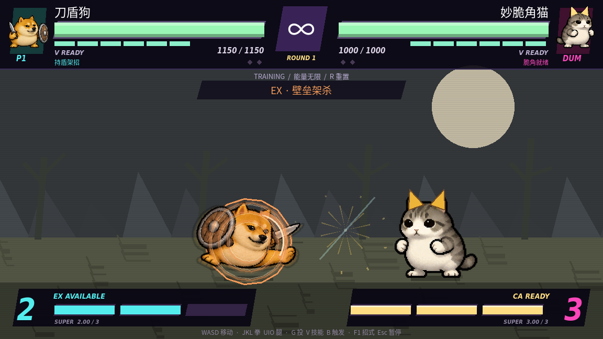

# 技能特效、动作与打击音效

后续版本已升级命中确认连段、填充刀光、叠加光晕和 CA 终结；请看[新版连段说明](COMBO_GUIDE.md)。

本轮参考街霸、拳皇常见的街机格斗反馈方式：命中爆点、格挡蓝弧、斩击轨迹、EX 金色蓄光、突进残影与短暂顿帧。特效由程序绘制，音效为原创分层合成，没有使用这两款游戏的素材。

六角色全部 18 个必杀及对应 EX 版本接入独立动作曲线，包含预备、发力、回收。动作继续使用现有关键姿势、位移、旋转与挤压变形，没有新增完整逐帧手绘图集。

| 角色 | 视觉与声音 |
| --- | --- |
| 咕咕嘎嘎 | 多层音波拖尾、滑冲速度线、旋踢弧、空中残影；音波与风切声 |
| 刀盾狗 | 盾撞防御弧、上挑刀光、回旋斩弧、金属命中层 |
| 妙脆角猫 | 脆角弹旋转、碎片陷阱、当身光环；碎裂与反击声 |
| 奶蛙 | 黏液拖尾、低身突进线、EX 翻滚、落地烟尘 |
| 牛来 | 沉重冲撞、牛角上挑、震地碎石和地面波；低频重击 |
| 美团袋鼠 | 踢击弧光、突进残影、旋转外卖箱与反弹；腿风和抛掷声 |

命中按轻中重分层；格挡使用蓝色火花，盾牌另叠金属材质。反击有独立扩散环与音色。命中顿帧约 35–65 毫秒，格挡约 15 毫秒，附带轻微舞台震动；HUD 保持稳定。突进残影复用独立透明帧，因此不会重新引入图集串帧或刀尖裁切。

19 个短音效位于 `assets/audio/combat/`。包含挥拳、腿风、轻中重命中、格挡、金属、斩击、音波、碎片、黏液、震地、上挑、反击、EX、CA、落地、强化、投技。M 静音会同时停止旧声音与新增音效。原版梗人声尚未导入，现有 `.ogg` 人声覆盖接口保留。

练习模式按 **1／2／3** 快速施放三种必杀，**Shift + 1／2／3** 为 EX，**4** 为 CA；正常搓招仍可使用。F3 可观看六角色 72 秒演出。

验证：全部六角色战斗回归；36 种普通／EX 技能的动作范围与事件接入；19 个声音资源加载、长度与解码峰值；事件数量上限、回合清理、命中顿帧、静音；虚拟显示下六角色实际渲染截图。运行 `sh run.sh --headless --script res://tools/effects_check.gd`；有显示环境时同一脚本同时输出截图到 `/tmp/meme-fx-visual/`。
