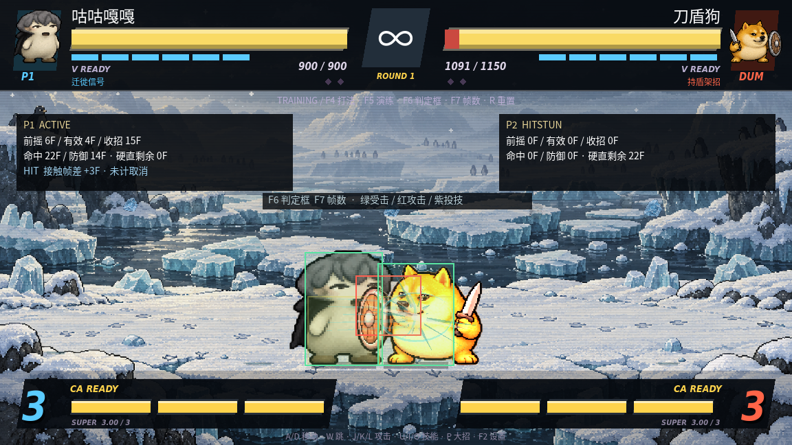

# 基础攻防与训练显示

本次改动把战斗的前摇、有效段、收招、命中硬直和防御硬直统一到 60Hz 帧单位。角色特色、六张主场与音频联动保留；普通攻击、必杀、CA、反击与投技通过同一套招式阶段结算。数据入口是 `scripts/combat_rules.gd`，状态和实际几何位于 `scripts/fighter.gd`。



## 默认操作

改键后，对应动作键继续生效；以下以默认键位说明。

| 操作 | 按键与规则 |
| --- | --- |
| 站防／蹲防 | 按远离攻击者的方向／同时按 S。防御硬直期间持续读取，允许切换上下防；受击硬直期间不能防御 |
| 前冲／后撤步 | 12F 内双击前／后方向；前冲 18F，后撤步 22F，过程中不能普通防御或出招。后撤步仅前 6F 免投，仍可被打击命中 |
| 跳跃 | W，地面起跳有 4F 准备；咕咕迁徙中的二段跳继续保留 |
| 普通投 | G，5F 前摇、2F 有效、24F 收招，空投可以被确反 |
| 拆投 | 被普通投抓住后按 G；7F 窗口包含抓住的接触时刻，伤害在窗口结束后结算。最后合法时刻仍可拆；双方同时普通投也会拆开 |
| 普通／快速／后撤起身 | 不操作／倒地后按 W／倒地后按后方向；地面等待分别为 30F／14F／24F，之后有 6F 起身过程。后撤起身移动 68 像素，并受场地边界限制 |
| 起身保护 | 可行动后的前 5F 免投，但打击可在第一个可行动帧命中；地面倒地与起身过程中不可受击，空中仍按浮空规则结算 |
| 输入缓冲 | 动作输入保留 5F，在硬直或收招结束后执行；太早的输入会过期。跳跃、投、V 和技能也可在硬直末尾缓冲 |
| 训练帧数／判定框 | F7／F6；训练模式默认显示帧数，框体默认关闭 |

普通投不能抓受击／防御硬直中的人，不能抓空中、倒地／起身、免投保护中的人。牛来 CA 的指令投属于超必杀例外：不可普通拆投，可按已有路线接入连段；普通投的新拆投规则不会把 CA 变成可拆的普通投。

## 防御与确反

- 防御硬直与受击硬直分开记录，持续拉后不会在多段攻击中无故掉防。防御方向按攻击者实际所在一侧计算，旧朝向不会自动挡住逆向攻击。
- 普通攻击的有效段结束后仍须完成收招，不能在收招中主动走路、起跳或普通格挡。明确设计为举盾／后撤架招的专属防御技保留其特殊防御能力，不能将它们当作普通格挡例外去取消所有收招。
- 轻→中→重、命中取消、必杀→CA、奶蛙 V 取消按真实确认执行；空挥不能凭输入绕过收招。EX 补正仅允许在当前必杀尚未生效的前摇中替换，不能在空挥收招中重新发动。反击先进入自己的 4F 前摇，再用实际判定命中，不再直接远程扣对手血。
- 飞行道具与布置陷阱有 12F 前摇，在实际释放时生成；起手被打断就不会凭空发射。搓招完成方向必须足够新近，0.6 秒前的波动不会继续抢普通攻击。

## 帧数口径

普通招的基准数据如下；猫、牛来有各自前摇，奶蛙和牛来有各自收招，奶蛙触发也会修改实际收招，面板读取修改后的数据。

| 普通招 | 前摇 | 有效 | 收招 | 命中硬直 | 防御硬直 |
| --- | --- | --- | --- | --- | --- |
| 轻 | 4F | 3F | 10F | 17F | 11F |
| 中 | 6F | 4F | 15F | 22F | 14F |
| 重 | 9F | 5F | 21F | 28F | 18F |

多数近身必杀基准前摇 8F，CA 基准前摇 12F（在演出冻结结束后继续推进）。多段招的有效段总长包含段间空隙，只有实际攻击窗口显示红框；空隙显示 `ACTIVE GAP`。计时不会在 hit-stop、暂停、手册或 CA 全局演出冻结时偷偷推进。

面板显示当前阶段、实际招式数据、剩余硬直及最近一次接触时的帧差估算。帧差是「对方剩余硬直 − 自己剩余招式时间」，**不计后续取消、空中落地或弹体后续变化**，不将它冒充所有场景的最终确反结论。倒地／起身和拆投窗口分别显示剩余帧。

## 判定框口径

- 绿色：实际受击框；蓝色：打击无敌期间的受击框。
- 红色：当前有效攻击框；暗金色：前摇／多段空隙中的预览，不会造成命中。
- 紫色：投技范围；橙色：飞行道具与陷阱；淡黄色：角色身体挤压框。

碰撞与训练绘制调用同一组几何函数。角色有各自的躯干宽高，蹲姿／低姿态缩小受击高度；角落会将未完成的身体分离量推给另一个角色，不再只夹住一人后留下重叠。当前是基础躯干框与招式框，不是逐帧拟合每根肢体的完整竞技判定资产。

## 验证

```sh
cd /workspace/rouge/meme-brawl
sh run.sh --headless --editor --import --quit
python3 tools/validate_combat.py
# 有图形显示时，保存训练界面实机截图
timeout 60 sh run.sh --audio-driver Dummy --max-fps 30 \
  --script res://tools/combat_rules_check.gd -- --capture-combat
```

统一验证器执行攻防、完整战斗、连段、角色演练、改键、地图、音频与特效 8 组测试。每组都检查退出码、实际 PASS 标记以及是否出现 `SCRIPT ERROR`／`ERROR:`，不会把打印过 PASS 但仍有断言的运行当成功。

攻防回归覆盖 51 项检查，包括持续防御六段 CA、空挥确反、硬直末尾／过期输入、实际前摇／有效／收招、近身与空投、及时／迟拆／同时投、指令投例外、快速／后撤起身、起身免投与打击压起身、冲刺／后撤步、起跳、道具延迟／打断、上下防、逆向防御及角落挤压。原有六角色完整连段和奶蛙 14 连击也保留检查。这是规则与功能验证，不是完成真人对战平衡的证明。
