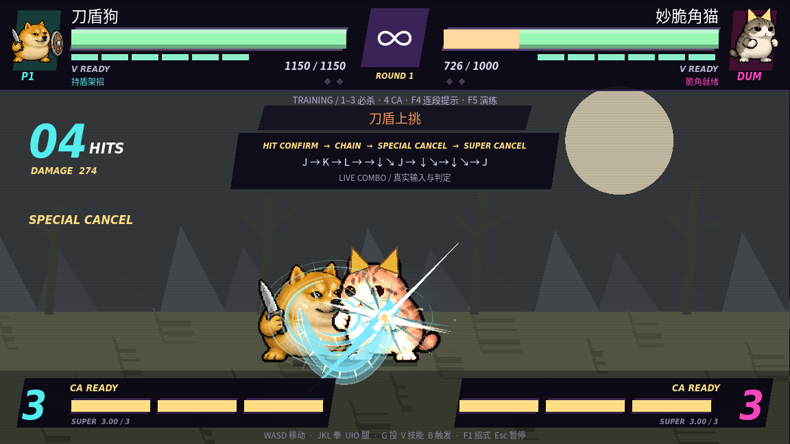
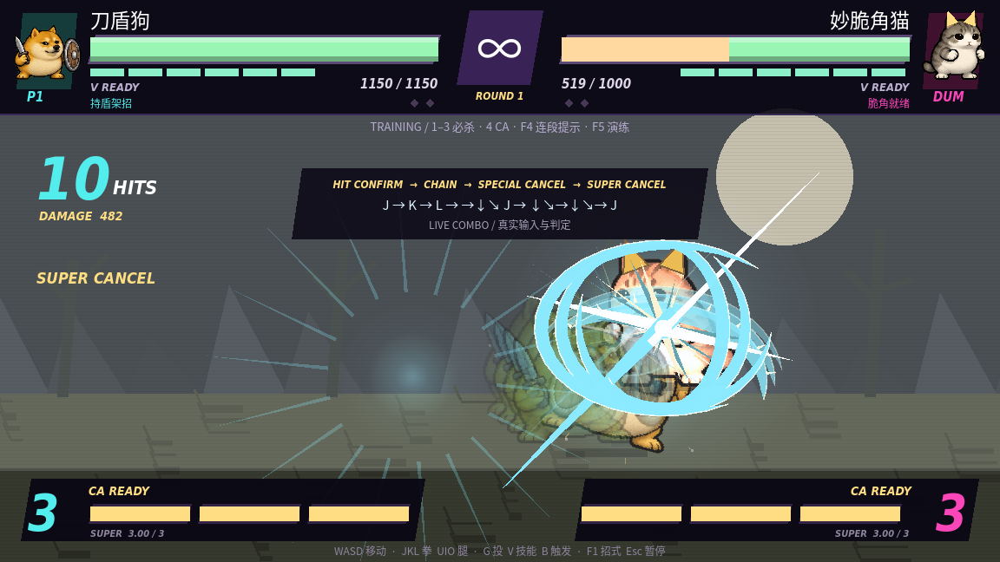
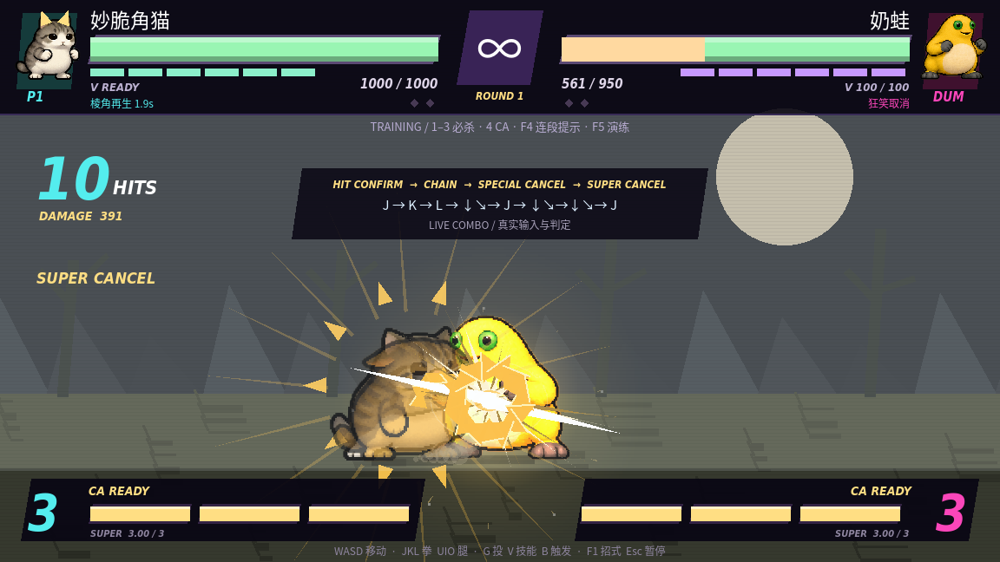

# 连段与技能演出升级

当前版本已加入[简化数字技能与角色分工](ROLE_GUIDE.md)。F5 使用各角色专属演练，奶蛙为 14 连击；本页保留基础连段与传统搓招的进阶说明。

现在有可操作的连段规则。参考街霸的命中确认、必杀取消、超必杀取消，以及拳皇常见的连续技节奏、残影和强烈终结反馈；采用本作自己的简化规则。

## 怎么接

近身 **J → K → L → 必杀 → CA**。每一段命中后再按下一段，可以借助命中顿帧输入。普通攻击按轻 → 中 → 重升级，拳、腿可以交替，但不能在取消中退回更轻等级。

| 角色 | 重拳后衔接的必杀 | 最后衔接 CA |
| --- | --- | --- |
| 咕咕嘎嘎 | ↓↘→ + J，音波弹 | ↓↘→↓↘→ + J |
| 刀盾狗 | →↓↘ + J，上挑 | ↓↘→↓↘→ + J |
| 妙脆角猫 | ↓↘→ + J，脆角弹 | ↓↘→↓↘→ + J |
| 奶蛙 | →↓↘ + J，突进 | ↓↘→↓↘→ + J |
| 牛来 | ↓↙← + J，踩地 | ↓↙←↓↙← + J |
| 美团袋鼠 | ↓↘→ + U，重踢 | ↓↘→↓↘→ + U |

六条路线均可形成 **10 连击：三次普攻 + 一次必杀命中 + 六段 CA**。需要近身、CA 前满三格能量。练习模式提供无限能量：**F4** 显示／隐藏角色路线，**F5** 重置场地并演练当前角色的专属打法（见新版角色说明）。演练调用与玩家相同的出招、碰撞和受击逻辑。

练习快捷键仍为 **1／2／3** 必杀、**Shift + 数字** EX、**4** CA。可先用快捷键熟悉取消时机，再练搓招。

## 规则

- 有效命中才开放 0.3 秒取消窗口；空挥、被格挡、被打断不能获得本作的命中取消。EX 双重攻击升级只允许紧接同一必杀的输入宽容窗口。
- 普攻可取消到更重普攻或必杀；普攻、必杀可取消到 CA。盾反、猫当身、袋鼠反击成功后也能接 CA。
- 0.14 秒单次输入缓冲保留略早按下的攻击；只缓冲一招，不储存整套连段。
- 连段每增加一次已命中攻击，下一击基础伤害系数降低 8.5 个百分点；普通攻击最低 35%，CA 最低 50%。实际扣血仍考虑克制、角色状态等已有规则。
- 上挑可浮空，普通空中追击受四次上限约束；CA 可以作为终结接入。对手恢复受击硬直后，下一次攻击会重新计算连段。
- CA 特写、命中顿帧和暂停不消耗连击计时。界面显示实际 HITS、累计 DAMAGE，以及 CHAIN、SPECIAL CANCEL、SUPER CANCEL 提示。

刀盾狗 EX 连环突刺现在为三段攻击；奶蛙、袋鼠部分 EX 多段追击有短跳／突进动作，最后一段击飞。成功取消会出现独立光效和声音。

## 演出变化

技能轨迹从简单线条改为多层渐细的填充刀光、白色亮芯、角色专属色和独立叠加光晕；突进残影加密，刀光跟随出招者。拳风与腿弧分开，音波、脆角、黏液与外卖箱有不同拖尾。CA 连续命中和最后一击分别触发小冲击与大型终结效果，附带更强顿帧、碎片和低频打击。

普攻、必杀加入蓄势—快速发力—回收的动作曲线；CA 按角色分别处理音波后仰、刀盾连斩、猫的静止爆发、蛙的疯扑、牛的重击与袋鼠踩击。动画继续使用本工程的关键姿势图集与程序变换。

以下截图取自实际连续碰撞产生的第四击和第十击，没有注入假连击数字或假伤害。

## 验证

`sh run.sh --headless --script res://tools/combo_check.gd` 验证六角色完整 10 连击，并额外使用真实击退重跑六条路线，确认不依赖木桩的零速度。覆盖缓冲、空挥与格挡拒绝取消、等级顺序、旧飞行道具不能确认新动作、伤害衰减、追击上限、EX 三段和反击接 CA。

`sh run.sh --script res://tools/combo_visual.gd` 在有显示环境时捕捉六个真实连段的必杀接触帧与第十击，验证终结事件存在。现有战斗回归、36 种必杀／EX 效果检查和贴图隔离检查继续通过。

新版根目录 `Meme-Brawl-Showcase.mp4` 为 72 秒六角色不同打法 + EX 演示；`F3` 的原有 VS／CA／KO 鉴赏仍可使用。录制脚本为 `tools/combo_showcase.gd`。
