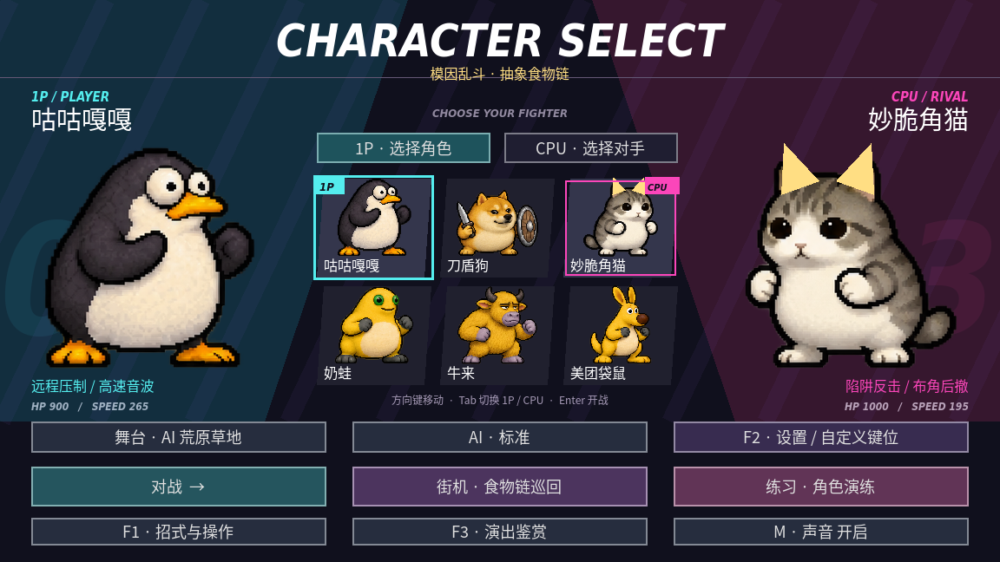
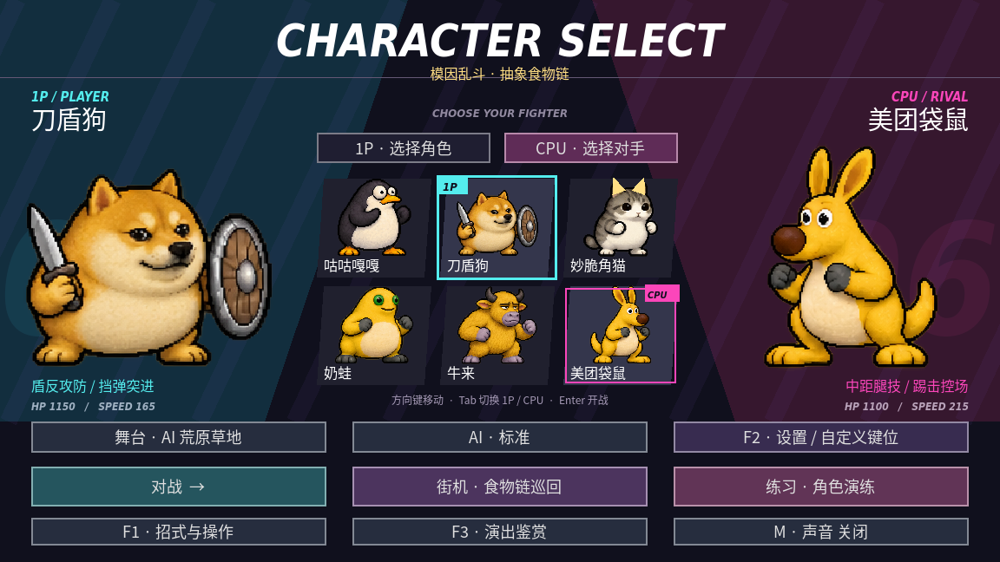
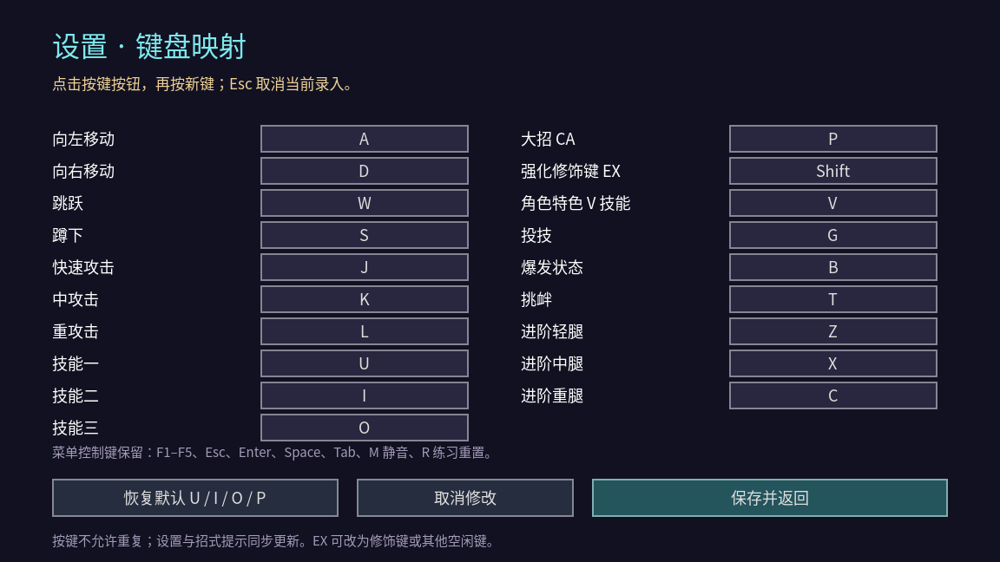
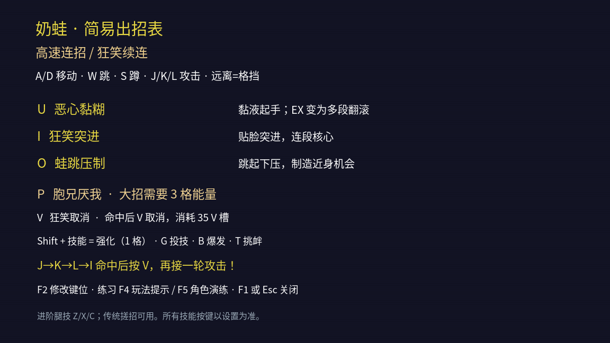
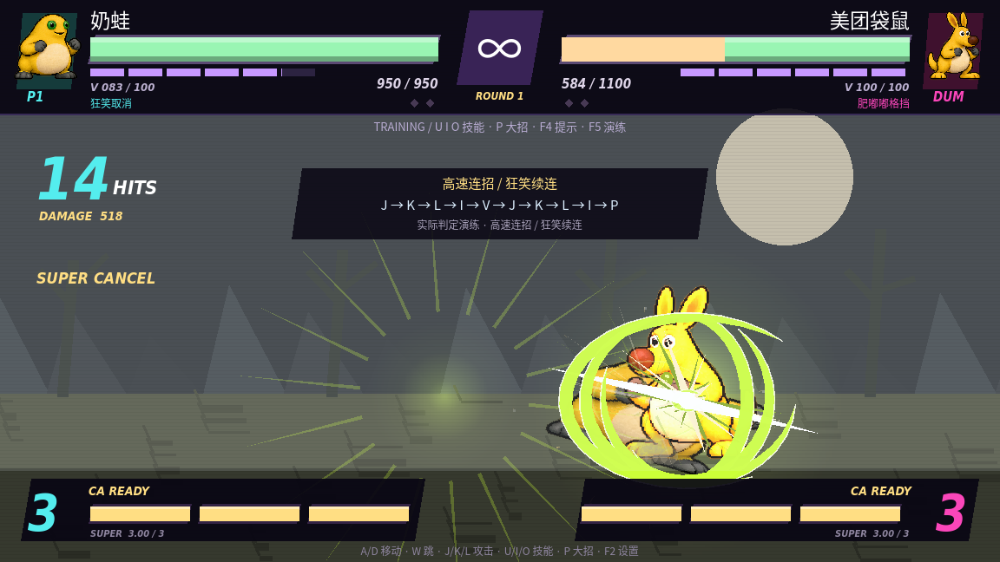

# 选角与自定义键位

选角页采用双侧大幅角色展示、中央六人头像格、青色 1P 和粉色 CPU 游标。点击头像选择角色；先点击「CPU · 选择对手」即可独立选择对手。方向键移动游标，Tab 切换选择方，Enter 开始对战。舞台、难度、对战／街机／练习入口集中在底部。

## 默认操作

| 操作 | 默认键位 |
| --- | --- |
| 左 / 右 / 跳 / 蹲 | A / D / W / S |
| 快 / 中 / 重攻击 | J / K / L |
| 技能一 / 二 / 三 | **U / I / O** |
| 大招 CA | **P**，消耗三格 |
| 强化 EX | Shift + U / I / O，消耗一格 |
| 角色特色 / 投技 / 爆发 / 挑衅 | V / G / B / T |
| 进阶轻 / 中 / 重腿 | Z / X / C |
| 设置 | F2 |

原 U/I/O 腿技迁到 Z/X/C，避免与技能冲突。传统搓招仍可配合当前攻击键使用。选角页的数字 1–6 仅作为头像快捷选择，正式对战不再把数字 1–4 作为默认技能。

## 如何改键

1. 在选角页点击「F2 · 设置 / 自定义键位」，或在对局中按 F2。
2. 点击某项操作右边的按键按钮，再按希望使用的新键。
3. 点击「保存并返回」。下次启动自动读取绑定。

19 个战斗操作都能修改，包含移动、跳蹲、普攻、技能、大招、EX 修饰键、特色技能、投技、爆发、挑衅和进阶腿技。EX 修饰键可以设为 Ctrl、Alt 或其他空闲键。

重复绑定会显示冲突操作，不覆盖现有绑定。F1–F5、Esc、Enter、Space、Tab、M 静音、R 练习重置保留给界面操作。录入时按 Esc 只取消当前录入；未录入时 Esc 或「取消修改」会恢复进入设置前的全部绑定。「恢复默认」之后仍需点击保存。

配置写入 Godot 用户数据目录的 `controls.cfg`，采用临时文件写入后替换；工程 ZIP 不包含用户个人配置。配置缺失时使用默认键位，非法配置不会覆盖有效的内存绑定。设置页会暂停对局，返回时恢复原先的对战／暂停状态；失去窗口焦点会释放按键状态，避免持续走路。

F1 出招表、F4 玩法提示、角色演练路线、战斗底部操作提示都读取当前绑定。例如把技能一从 U 改为 Q 后，提示会同步显示 Q。

## 验证

`sh run.sh --headless --script res://tools/controls_check.gd` 验证 UIOP 默认、冲突与保留键、配置重复保存与重载、非法配置、录入与 Esc 取消、取消修改回滚、对局冻结与恢复、自定义 EX、移动／跳跃重绑定、失焦释放、动态提示及双侧头像导航。

`sh run.sh --script res://tools/menu_visual.gd` 在图形环境中验证真实鼠标事件选择整张头像、切换 CPU、进入设置、键盘事件录入、UIOP 出招表及奶蛙真实 14 连击。已有角色机制、基础连段、战斗、技能特效与隔离贴图回归继续通过。

根目录的 72 秒 `Meme-Brawl-Showcase.mp4` 展示新选角页、设置录入与恢复默认，以及六角色玩法。录制脚本为 `tools/interface_showcase.gd`。
