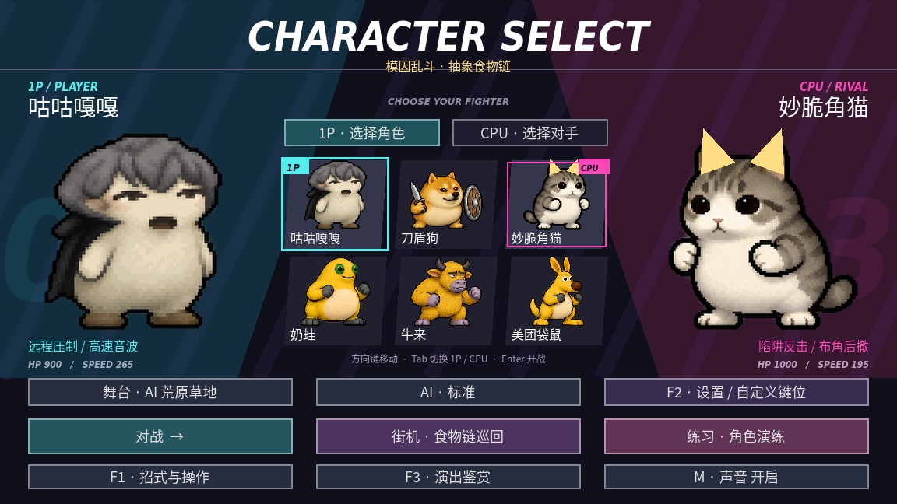
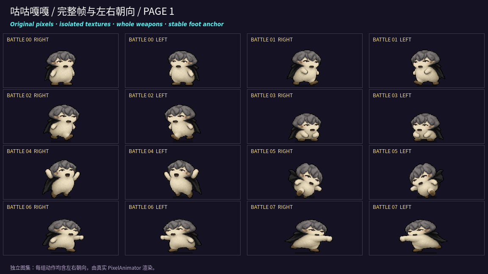
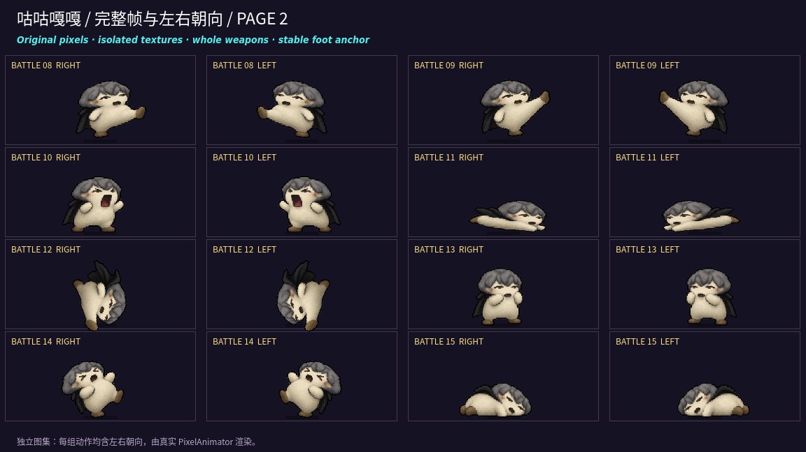
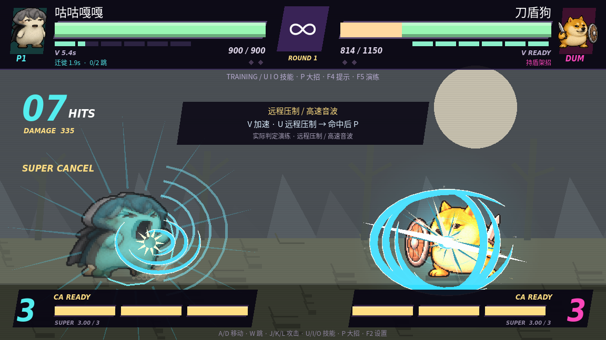

# 咕咕嘎嘎：按用户参考图重制

以用户本轮上传的参考图为当前视觉依据：灰色卷曲短发、奶白色圆身、眯眼小嘴、黑色小披风、短手短脚。采用与游戏其他角色一致的粗像素轮廓和颗粒阴影，保留参考图里笨拙、粗糙的低模迷因质感。

已替换 `assets/art/gugu_actions.png`。选角立绘、头像、VS、CA 与对战均使用这张独立图集。共享总图集中的旧版首列作为历史源素材保留，不用于当前咕咕嘎嘎显示。

新图集包含 **16 个完整姿势**：

| 行 | 四个姿势 |
| --- | --- |
| 第一行 | 待机、两种迈步、蹲下 |
| 第二行 | 起跳、下落、轻拳、重拳 |
| 第三行 | 低踢、高踢、张嘴音波、披风滑冲 |
| 第四行 | 空中旋踢、格挡、受击、倒地 |

16 个姿势接入现有 27 种动画状态和动作曲线；左右朝向通过镜像显示。贴图重新生成独立像素归属数据，保留完整头发、披风、拳脚边缘与脚底基准。

招式名称调整为「披风滑冲」「卷毛回旋」「EX · 群体咕嘎」「EX · 披风俯冲」，配合新形象。高速音波、远程拉扯、V 加速和二段跳机制继续使用，默认 U/I/O 技能、P 大招与 F2 改键功能保留。

素材为根据用户附图生成的游戏像素重绘；没有将参考小图直接放大充当战斗动画。原图没有另行打包，造型依据和图集哈希记录在 `assets/art/sources.json`。

验证：重新导入纹理并生成 `frame_manifest.json`；56 帧归属检查无像素丢失／共享；16 姿势左右朝向实机检查通过；六角色战斗、基础连段、角色演练、UIOP 改键、技能特效回归通过。当前演示视频也使用新形象。
