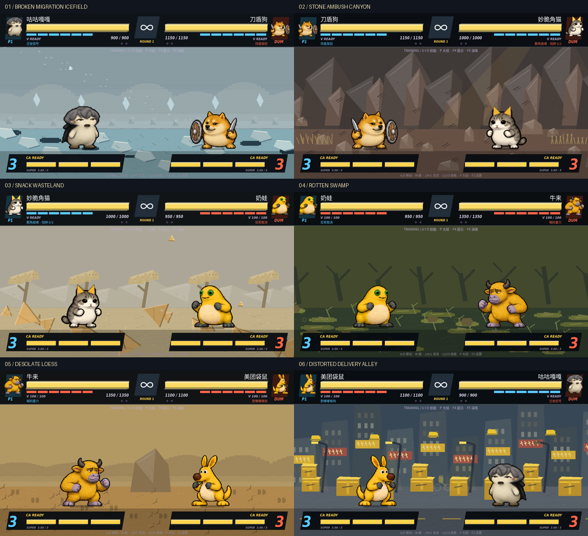

# 六张角色主场

全部由 Godot 原生绘制，无外部贴图下载要求。采用像素化边缘、低饱和环境色、分层远景和局部材质纹理，保留当前像素角色与街机 HUD。脚本在 `scripts/home_stages.gd`，背景层位于角色后方，物理地面仍为原有 y=532；地图装饰没有碰撞体、伤害或战斗飞行道具。



## 进入方式

默认普通对战／练习进入玩家角色的主场。选角界面可手动轮换六张地图；手动选图优先于角色自动匹配。街机模式在未手动指定时进入每个对手的主场。F3 演出按六角色切换主场。所有角色都可在任意地图对战；主场特效仅在对应角色和地图同时匹配时触发，双方均可触发，不加伤害和隐藏数值。

| 角色／地图 | 场景与持续动态 | 战斗联动 |
| --- | --- | --- |
| 咕咕嘎嘎／破碎迁徙冰原 | 灰白淡青脏蓝；融冰板块、浑水池、双排脚印、漂浮冰棱、模糊雪山、踱步企鹅虚影、方块碎雪；随机落冰与无伤害冲击环，水池慢慢开合 | 主场每回合开局显示小声「咕咕～」并播放轻柔合成鸟鸣；远处间歇回声 |
| 刀盾狗／乱石伏击谷 | 暗棕灰红峡壁、埋地／浮空碎石、岩壁与地面刀痕、枯草、斜照黄光；随机碎石掉落，远处猎物闪过 | 必杀使全场刀痕发亮，随后衰减 |
| 妙脆角猫／零食荒原 | 米黄灰橙荒原、巨型脆角、带咬痕的零食、膨化饼干矮树；碎屑随风滚动，脆角慢落 | CA 期间场地脆角竖起，结束后恢复 |
| 奶蛙／腐臭沼泽洼地 | 黄绿灰褐浑黑水、腐叶、歪水草、枯树、蠕动泥包；持续气泡和间歇无害黏液喷溅 | 超必杀使水面翻涌并大量爆泡 |
| 牛来／枯寂黄土坡 | 单调黄天、模糊低丘、巨大蹄印、干裂地面、中央孤立歪石；稀疏黄尘 | V 蓄力时显现半透明黄色人形；重击命中／牛来落地使裂纹暂时扩展并扬尘 |
| 美团袋鼠／扭曲外卖街巷 | 黄灰蓝脏红街道、歪楼、不可读招牌、堆叠外卖箱、悬浮头盔、频闪路灯、掠过的骑手影 | 超必杀使所有背景箱体炸散，结束后恢复 |

背景箱体炸散只作用于地图装饰，不清除角色技能生成的战斗箱体。冰块、脆角和黏液落点不改变角色碰撞。视觉粒子池上限 80，随机视觉使用独立种子，不改变战斗随机序列；暂停或打开手册时冻结，重新开局清空短时联动。

## 主场音乐

对战／结算使用地图对应的六首新氛围曲，菜单仍用角色配乐。跨地图或退出对战时交叉淡入淡出；台词、CA 与静音规则沿用现有混音系统。

- 冰原：空灵、发闷的电子铺底与间歇合成鸟鸣。
- 峡谷：低沉贝斯和磨刀质感的金属摩擦。
- 零食荒原：慵懒的低速拨弦与细碎沙沙声。
- 沼泽：潮湿低频、合成蛙鸣与断续笑声节奏。
- 黄土坡：空旷慢弦乐和闷蹄声。
- 街巷：快节奏电子、杂响和抽象订单提示音。

新增音频是原创程序作曲／合成，**非原版梗声录音**；「咕咕～」是字幕配合合成鸟鸣，并非真人台词。曲目、时长、BPM、SHA-256 在 `assets/audio/stages/manifest.json`。生成脚本 `tools/build_stage_audio.py` 依赖 NumPy 和 FFmpeg，常规运行直接读随附 Ogg。

## 验证

```sh
cd /workspace/rouge/meme-brawl
sh run.sh --headless --editor --import --quit
timeout 60 sh run.sh --headless --audio-driver Dummy --script res://tools/home_stages_check.gd
timeout 60 sh run.sh --headless --audio-driver Dummy --script res://tools/character_audio_check.gd
timeout 60 sh run.sh --headless -- --smoke-test
# 可选：有图形显示时重新捕获六张主场及联动画面
sh run.sh --audio-driver Dummy --max-fps 30 --script res://tools/home_stages_check.gd -- --capture-stages
```

地图检查覆盖六图、默认／手动选择、街机对手主场、实际必杀／CA 入口、暂停与重置、装饰不扣血／能量、不注册战斗飞行道具、粒子数量上限、地图音乐选择以及咕咕主场开局提示。已通过实际 OpenGL 渲染保存 `docs/stages/stage_0.png` 至 `stage_5.png` 与对应 `_link` 截图。Dummy 音频驱动检查播放逻辑；不等于真人试听。
