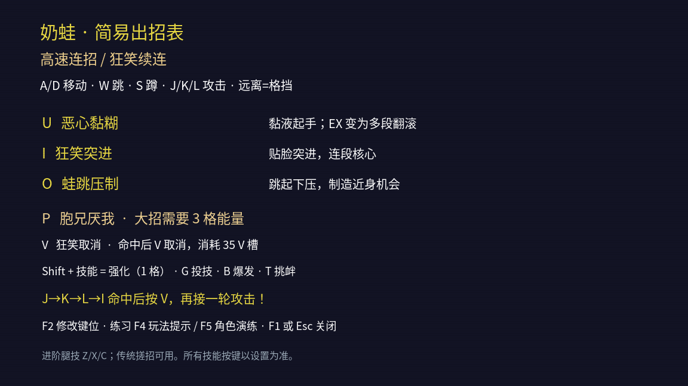
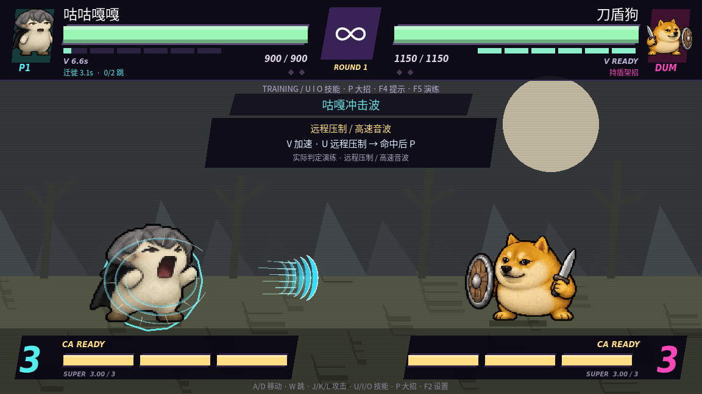
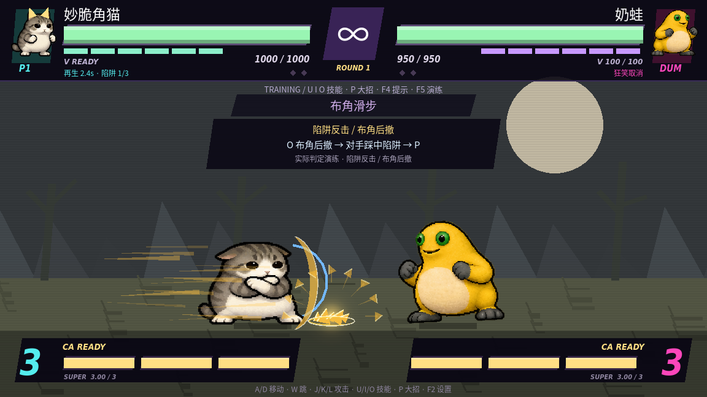
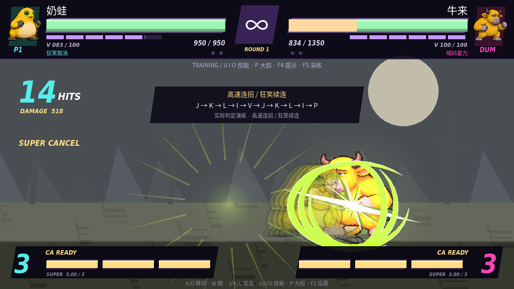

# 简化出招与六角色打法

默认使用 U/I/O/P 施放技能与大招，F2 可自行改键，正式对战、街机和练习都能使用。按 **F1** 看当前角色的简易出招表。[设置与改键说明](CONTROLS_GUIDE.md)。

| 操作 | 按键 |
| --- | --- |
| 移动、跳、蹲 | WASD |
| 快、中、重攻击 | J / K / L；袋鼠默认踢技 |
| 三个技能 | U / I / O |
| 强化技能 EX | Shift + U / I / O，消耗一格 |
| 大招 CA | P，消耗三格 |
| 角色特色 / 投技 | V / G |
| 练习玩法提示 / 角色演练 | F4 / F5 |

传统搓招和 Z/X/C 腿技作为进阶操作保留。技能快捷键仍需遵守硬直、资源、命中确认与取消规则。

| 角色 | 主要打法 | U | I | O | 核心特色 |
| --- | --- | --- | --- | --- | --- |
| 咕咕嘎嘎 | **远程压制** | 高速音波 | 滑冲 | 空中旋踢 | 音波快、出招间隔短、击退更远；V 加速与二段跳，普通攻击伤害较低 |
| 刀盾狗 | **盾反攻防** | 举盾冲撞 | 上挑 | 回旋斩 | 冲撞期间挡高位弹；低段和近身攻击能打断。V 接攻击反斩，可接 4 |
| 妙脆角猫 | **陷阱反击** | 慢速脆角弹 | 当身反击 | 布角后撤 | 直接留下陷阱并后撤，最多三处；EX O 铺三处并短暂当身。角暂时消失时陷阱较弱 |
| 奶蛙 | **高速连招** | 黏液 / EX 翻滚 | 贴脸突进 | 跳压 | 普攻回收快、单击较轻；命中后 V 花 35 点清硬直，继续第二轮连招 |
| 牛来 | **蓄力重击** | 冲撞 | 牛角上挑 | 踩地 | V 蓄力强化下一必杀；重攻击有短暂霸体和更强削血，G 投技伤害高；移速慢 |
| 美团袋鼠 | **中距离踢击** | 重踢 | 对空上挑 | 弹跳箱 | J/K/L 直接踢击，攻击范围更长且推开对手；用腿和箱子守住中距离 |

## 一眼看懂的打法

- **想放波、拉扯：选咕咕嘎嘎。** 保持距离按 U，近身用 I 脱离，V 加速转移。
- **想打连段：选奶蛙。** `J → K → L → I → V → J → K → L → I → P`。从近身命中开始，完成后为真实 **14 连击**；V 会消耗资源，空挥不能续连。
- **想挡住再反杀：选刀盾狗。** `U` 挡弹逼近，`V` 接住近身攻击，成功后 `P`。
- **想设局：选妙脆角猫。** `O` 布角后撤，`U` 慢弹逼对手走位；对手踩角后接 `P`，被贴脸用 `I/V` 当身。
- **想一击够痛：选牛来。** 先 `V` 蓄力，再 `U/O` 打重击；近身可用 `G` 重投。蓄力中被打会清空。
- **想用攻击距离赢：选袋鼠。** 在普通拳头够不到的位置按 `K`，命中后 `U → P`。贴脸时优势会减少。

F5 演练分别展示远距音波、盾反、陷阱诱敌、奶蛙续连、蓄力重击和中距踢击，使用实际碰撞、资源和取消判定。它们的连续命中数分别为 7、7、7、14、7、8。

AI 也按角色选择距离和技能：咕咕嘎嘎后撤放波，猫布角与反击，狗靠盾逼近，奶蛙积极衔接和 V 续连，牛来蓄力冲撞，袋鼠停在中距离使用腿技。

## 实机画面

## 验证

`sh run.sh --headless --script res://tools/roles_check.gd` 检查正式对战的当前绑定／Shift 强化／大招、六种演练实际命中、咕咕嘎嘎与猫的弹速和出招间隔差异、咕咕嘎嘎 AI 后撤、狗盾冲的高位弹防御和低段弱点、猫陷阱上限与伤害、牛来重击霸体及袋鼠中距腿技。

已有战斗回归、六角色基础连段及真实击退测试、36 种技能效果检查、隔离贴图检查继续通过。`tools/roles_visual.gd` 在图形环境输出本页截图，`tools/interface_showcase.gd` 录制选角、改键与六种特色演练的 72 秒视频。
