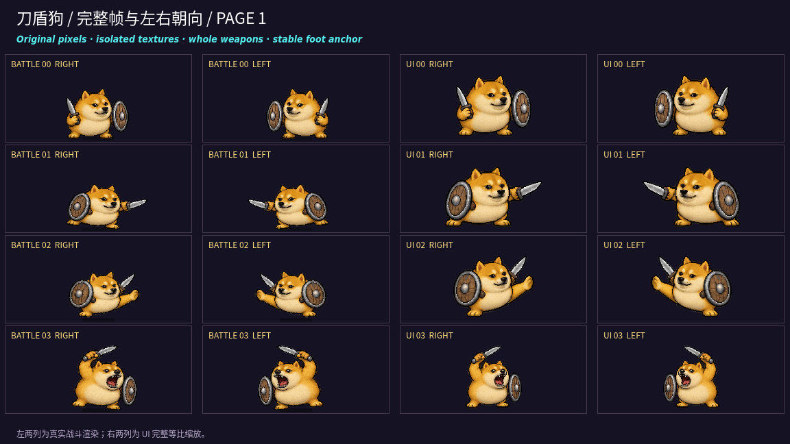
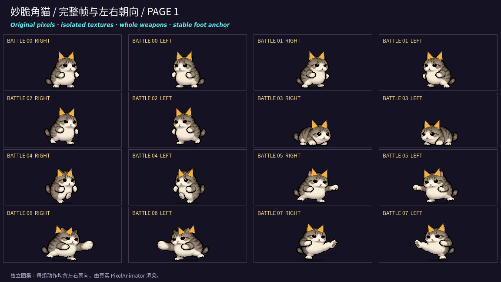
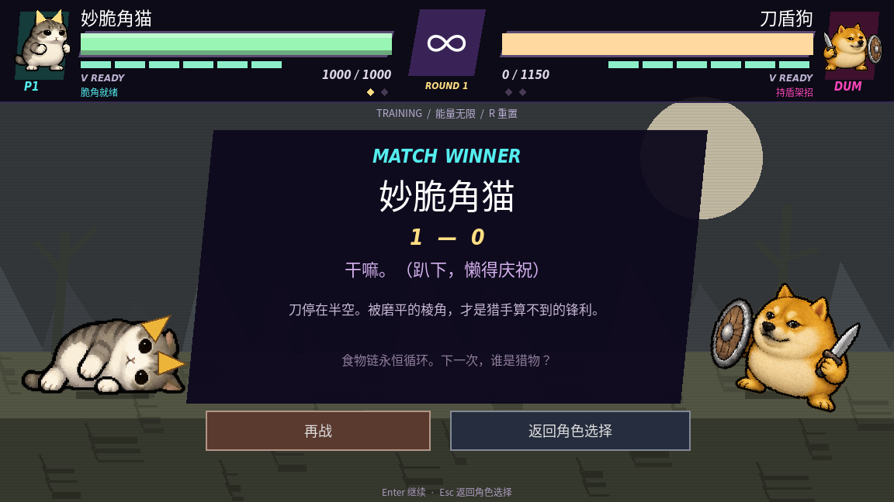

# 动作贴图串帧与裁切修复

## 原因

原图人物实际超出名义等分格：刀盾狗突刺刀尖超过 x=512，举刀部分进入上一行；企鹅与猫的大幅动作同样有跨格像素。统一 `grow(-10)` 裁切会截掉武器，并让邻格轮廓进入当前动作。低透明度背景连接也会造成残影。

## 修复

源 PNG 保持不变。`frame_manifest.json` 记录 56 帧的独立像素归属和透明边缘；运行时 `sprite_frames.gd` 为每帧创建独立透明纹理。战斗、EX、头像、选角、VS、CA 共用这套帧，绘制时不再对共享图集做等分采样。

- 完整保留可见身体与跨格武器；分离相邻角色像素。
- 战斗按身体脚底基准定位，避免逐帧上下跳位。
- UI 按完整轮廓等比缩放，包含武器和猫的独立脆角。
- 猫的脆角使用逐姿势头部锚点，跟随蹲伏、受击、躺下和朝向镜像。
- 原图内容发生变化时校验失败，需重新生成帧清单，避免旧清单静默套用新图。

## 实机检查图

通用图集检查图左两列为实际战斗渲染器，右两列为 UI 完整缩放。独立图集检查图每个动作均含左右朝向。







其他逐帧检查：[企鹅 1](sprite-audit/penguin-1.png)、[企鹅 2](sprite-audit/penguin-2.png)、[猫 2](sprite-audit/cat-2.png)、[奶蛙](sprite-audit/frog.png)、[牛来](sprite-audit/bull.png)、[袋鼠](sprite-audit/kangaroo.png)。

## 验证与重建

游戏运行只需 Godot，像素帧在启动时缓存；不需要 Python 或 SciPy。美术更新后可用以下维护工具重建并检查：

```sh
python3 -m pip install -r tools/requirements-frames.txt
python3 tools/build_frame_manifest.py
python3 tools/test_frame_manifest.py
sh run.sh --headless -- --smoke-test
# 有图形/虚拟显示时：
sh run.sh --audio-driver Dummy --max-fps 30 --script res://tools/sprite_audit.gd
```

Python 检查原图哈希、像素归属不重叠、强可见像素完整保留、跨格刀尖/举刀与独立图集跨格肢体。Godot 检查 56 帧解码像素与原图一致、脚底基准、UI 边界、脆角跟随、全部动作播放以及现有战斗逻辑。实机画面覆盖全部 56 帧及两种朝向。
