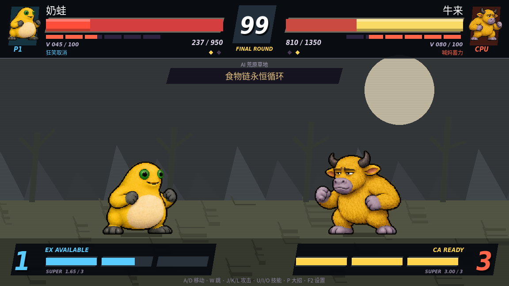
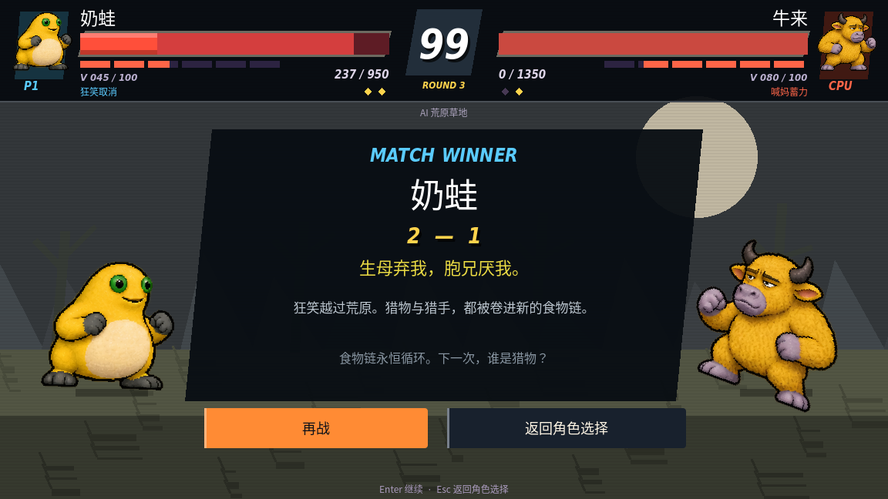
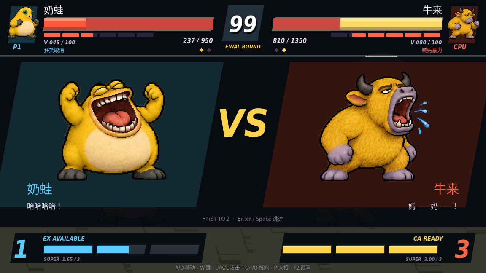
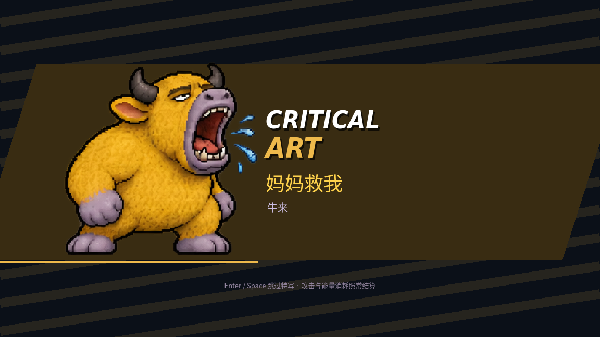

# 街机界面与过场

选角和全局视觉已升级，见[新版街机界面](ARCADE_UI.md)。

界面采用对称生命条、中央计时、回合胜点、底部三格超必杀槽和斜切深色信息板。布局参考街霸式格斗界面，画面与字体素材为本工程独立实现；玩法仍使用本作 EX、CA 与 V 机制。

## 战斗信息

- **生命**：上方显示头像、名字、当前/最大 HP；P1 蓝色、P2 红色标识。黄色生命随损伤变橙、变红，低于 25% 闪烁。受击后红色尾条延迟 0.35 秒追赶真实生命值，不代表可恢复生命。
- **V 槽**：生命下方的六段显示是同一条 V 资源的视觉分段。原三角色显示技能 7 秒冷却恢复进度；新三角色显示真实 0–100 V 资源，不是额外六格能量。
- **超必杀槽**：下方为实际 0–3 格能量。大数字表示完整可用格数，细槽保留小数进度。1 格显示 EX AVAILABLE，3 格显示 CA READY；EX 消耗 1 格、CA 消耗 3 格。
- **角色状态**：迁徙时间/跳跃次数、脆角再生、喊妈蓄力和 V 触发时间显示在对应角色下方。
- **连击**：按真实攻击方记录，受击硬直结束后的新攻击重新计数；显示 HITS 和本连击累计伤害。格挡不增加连击数。COUNTER HIT、PUNISH、THROW 与 BLOCK 反映实际受击状态，不额外修改伤害。



## 回合与结算

普通对战与街机每场均先胜两个回合。胜点菱形对应实际比分；1–1 时显示 FINAL ROUND。下一回合恢复生命、保留双方超必杀能量；重新开赛才清零比分。练习模式保留单回合重置。

KO 字样播放后进入回合/整场胜者面板，满 1 秒才开放按钮，避免误操作。Enter 继续或再战，Esc 返回选角。街机赢得整场后才进入下一名对手。



## 可跳过的过场

- 开场：双角色 VS、专属对话、最后 0.75 秒 FIGHT。完整开场约 4.2 秒。
- CA：独立角色特写、招式名、色彩条纹和进度扫线，普通对战约 1.25 秒。
- Enter/空格跳过开场或 CA 特写。跳过 CA 只结束画面暂停，不返还能量，也不取消后续攻击判定。
- KO、胜负动画与角色像素动作相连。暂停和招式手册仍可用。





## 72 秒演出鉴赏

在选角界面点击“演出鉴赏”，或按 F3。六角色各有一段约 12 秒的编排，包含 VS、AI 交手、预定 CA、KO 与回合胜利。它是**脚本编排演示，不是完整竞技对局录像**。演示中 CA 特写延长到约 2.2 秒。

- Enter/空格：当前开场/CA 中跳过特写，其他时段跳到下一角色片段。
- Esc/F3：立即退出演示，返回选角，不必看完全部。
- 菜单声音按钮或 M 可静音。

仓库根目录 [Meme-Brawl-Showcase.mp4](https://github.com/2502511622-rgb/rouge/raw/refs/heads/main/Meme-Brawl-Showcase.mp4) 是引擎实机录制的完整演示：1152×648、30 FPS、约 72 秒，H.264/AAC。声音仍使用当前工程的合成音效；没有将其标为原版录音。

命令行也可启动自动演示：

```sh
sh run.sh -- --demo
# 录制完成后自动退出；录制使用图形/虚拟显示
sh run.sh --write-movie /tmp/showcase.avi --fixed-fps 30 -- --demo --auto-quit
```

## 验证

现有功能测试额外覆盖延迟血条、恢复同步、EX/CA 临界值、两种 V 资源、真实三局两胜、能量跨回合保留、跳过 CA 安全性、真实连击归属与中断、演示进度和退出。`tools/visual_check.gd` 渲染 HUD、选角、VS、CA、KO、胜者及角色状态截图。

本文截图来自引擎渲染的受控测试状态，用于同时展示低生命、分数和不同资源值。完整 MP4 则来自演示模式实际运行。

DejaVu 显示字体许可见 `assets/fonts/ArcadeDisplay-LICENSE.txt`；中文字体许可见同目录 Noto 许可文件。
